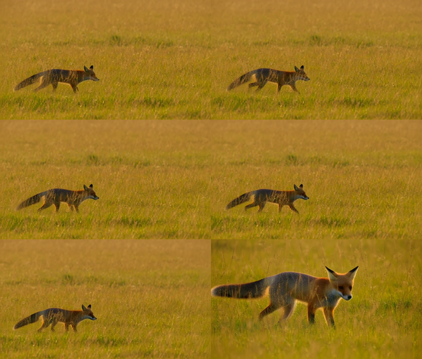

# videogen

[](https://github.com/JLFN/videogen)
[](LICENSE)

Local video generation with a synchronized soundtrack: a CLI and a recipe that
produce short clips with sound, on one machine, with no ComfyUI, no Python
service and no cloud API.

The runner is [stable-diffusion.cpp](https://github.com/leejet/stable-diffusion.cpp)
with GGUF weights. The model is **MiniMax-H3** (the FL2VA partition: text, first
frame and last frame to audio plus video) with two published **4-step turbo
LoRAs** that are applied through the prompt, exactly as stable-diffusion.cpp
expects them.



*A 73-frame clip at 960x544 made with `--preset turbo` (see
[docs/media/ab-turbo-6.json](docs/media/ab-turbo-6.json) for the report that run
wrote). Shot 1 holds a wide tracking frame; at 00:02.500 the prompt cuts to a
close-up, and the clip follows.*

## What it does

- **Video and audio in one pass.** MiniMax-H3 denoises the picture and a 32 kHz
  stereo soundtrack together, so the two are synchronized by construction.
- **Two independent dials.** A *preset* spends time (sampling steps) with the
  weights fixed: `turbo` runs a LoRA at 6 steps, `lightx` at 4, `quality` runs
  the base model at 28 with no LoRA. A *profile* spends memory (weight
  fidelity): a GGUF ladder from Q2_K (6.26 GiB) up to the unquantized
  transformer (61.73 GiB).
- **Quantized only because it has to be.** The reference deployment is a split
  diffusers pipeline whose two halves are 62.15 GiB and 72.16 GiB resident,
  134.3 GiB together. Same checkpoint, same adapters, a bit width that fits.
  See [docs/DESIGN.md](docs/DESIGN.md).
- **Field-structured prompting.** MiniMax publishes the prompt format the model
  was trained on, and it is not free prose; the CLI reads it from a file.
  See [docs/PROMPTING.md](docs/PROMPTING.md).
- **A report per run.** Every clip is written together with a JSON file
  recording the preset, profile, canvas, steps, seed, LoRA, artifacts and wall
  time, so a result can be traced back to the configuration that made it.
- **Normal output.** `sd-cli` cannot write H.264, so the wrapper remuxes its
  VP8 `.webm` to H.264 plus AAC `.mp4` with ffmpeg.

## Requirements

| Item | Detail |
|---|---|
| Host | Linux, arm64 or x86_64. A CUDA build uses the CUDA toolkit and `nvcc`; a CPU build works but is very slow. Other backends (Vulkan, Metal) are stable-diffusion.cpp options this recipe does not cover. |
| Memory | The standing profile is 44.9 GiB of weight files, and a run holds them all resident plus the sampler's working set. Plan for roughly 64 GB of memory; more headroom is better, since the working set grows with the canvas. |
| Disk | About 50 GB for the standing profile and the build tree. The full quant ladder in [models/MANIFEST.md](models/MANIFEST.md) is much larger and none of it is required. |
| Tools | `git`, `cmake`, `ninja` or `make`, a C/C++ toolchain, `nvcc` for the CUDA build, `ffmpeg` for the mp4 remux, and `curl` or the Hugging Face CLI for the downloads. |

## Quick start

```sh
git clone https://github.com/JLFN/videogen
cd videogen

bash scripts/start-videogen.sh recon      # report what this host provides
bash scripts/start-videogen.sh build      # clone and build sd-cli (CUDA by default)
bash scripts/start-videogen.sh download   # the 44.9 GiB standing profile, resumable
bash scripts/start-videogen.sh verify     # hash the artifacts against the ledger

bin/videogen --prompt-file examples/prompts/t2va-fox.txt --preset turbo
```

The last command writes `out/h3-<timestamp>-<seed>.mp4` and the matching
`.json` report. A 73-frame turbo run took 253 s on the reference host; the
canvas, the profile and the step count all move that number.

For a dry run that prints the exact `sd-cli` command line without running it:

```sh
bin/videogen --prompt-file examples/prompts/t2va-fox.txt --preset turbo --dry-run
```

## Presets and profiles

Two dials, deliberately independent. A preset changes how long sampling runs;
a profile changes how much memory the weights take.

| Preset | LoRA | Steps | What it is for |
|---|---|---:|---|
| `turbo` | larry (`ckpt850`, the reference deployment's default) | 6 | The fast path. A distilled adapter buys a large step reduction and pays for it in sampling fidelity. |
| `lightx` | lightx2v v1.2 | 4 | The more aggressive adapter; the fastest, and the most likely to over-sharpen. |
| `quality` | none | 28 | No adapter and the most steps: the base model's own trajectory. This recipe's working point rather than a vendor figure. |

| Profile | DiT | Weight total | Note |
|---|---|---:|---|
| `q8` (default) | pruned FL2VA Q8_0, 19.97 GiB | 44.9 GiB | The standing profile. |
| `q6` | pruned FL2VA Q6_K, 15.45 GiB | 37.8 GiB | Balances quality against memory. |
| `q4` | pruned FL2VA Q4_K, 10.64 GiB | 28.3 GiB | The smallest usable build. |
| `base-q4` | non-pruned FL2VA Q4_K_M, 17.49 GiB | 42.4 GiB | Non-pruned, for the pruned-against-non-pruned A/B. |
| `bf16` | the bf16 transformer, unquantized, 61.73 GiB | 81.7 GiB with a 14.6 GiB encoder | Closest to the reference deployment's own weights; the slowest, because those bytes are read at every step. |

`--steps` and `--lora` override whatever the preset chose. The full flags,
the frame-count rule and the memory arithmetic are in
[docs/USAGE.md](docs/USAGE.md).

## Documentation

| Document | What is in it |
|---|---|
| [docs/USAGE.md](docs/USAGE.md) | The full guide: build, download, verify, first clip, every flag, canvas and frame rules, output, memory planning, troubleshooting. |
| [docs/PROMPTING.md](docs/PROMPTING.md) | The official prompt structure, the rules that matter in practice, and the quality notes that decide the preset. |
| [docs/DESIGN.md](docs/DESIGN.md) | What the reference deployment is, why the unquantized pipeline does not fit, the artifact parity ladder, and the open question about the turbo LoRA on a pruned model. |
| [models/MANIFEST.md](models/MANIFEST.md) | Every pinned artifact with its revision and exact byte count, plus the alternatives. |
| [recipes/minimax-h3-turbo.yaml](recipes/minimax-h3-turbo.yaml) | The recipe contract: artifacts, launch template, shapes, and the evidence behind each setting. |

## Verification status

This is a working recipe with an honest boundary. Measured so far, on the
reference host:

| Result | Value |
|---|---|
| First clip, end to end | 960x544, 73 frames (3.042 s), 20 steps, larry LoRA, pruned Q8_0 DiT: 648 s, with 41,655 MB of peak memory released afterwards. |
| Turbo clip | 960x544, 73 frames, 6 steps, larry LoRA, pruned Q8_0 DiT: 253 s. |
| Soundtrack level | The prose-prompt run measures mean -57.6 dB, peak -33.9 dB over 196,608 samples; the same shape and seed with the field-structured prompt measures mean -44.6 dB, peak -32.4 dB. Writing `overall_soundscape` explicitly is what moves the level. |
| LoRA binding | `apply_loras completed` in the runner's output, so the adapter is applied. |
| Artifact integrity | Every file downloaded byte-exact against the manifest, and every pin re-verified against the live repositories when this repository was published. |

Not yet measured, and stated as such rather than implied:

- The native 1344x768 canvas end to end, and the peak memory a native-canvas
  request actually needs. Every run so far used a smaller canvas.
- The pruned-against-non-pruned A/B, and the larry / lightx / off comparison at
  identical seed and prompt.
- Whether the larry LoRA's AdaLN targets fold onto a pruned (curve-table)
  model key for key, beyond the absence of an error. This is the first A/B the
  recipe asks for; see [docs/DESIGN.md](docs/DESIGN.md).
- Loading the transformer from the safetensors republished from the original
  weights (`--profile bf16`); stable-diffusion.cpp's own H3 documentation names
  that repository as a source, and the recipe has not exercised it here.

## Layout

```
bin/videogen                     the CLI (bash, wraps sd-cli and ffmpeg)
scripts/start-videogen.sh        recon | build | download | verify | status | clean
recipes/minimax-h3-turbo.yaml    the recipe contract
models/MANIFEST.md               pinned artifacts, revisions, byte counts
examples/prompts/t2va-fox.txt    an example prompt in the official structure
docs/                            the usage guide, the prompting guide, the design notes
models/sd/, models/loras/        weights and adapters (gitignored)
out/                             generated clips and reports (gitignored)
```

## Attribution and license

- Model: [MiniMaxAI/MiniMax-H3](https://huggingface.co/MiniMaxAI/MiniMax-H3),
  released under the MiniMax H3 Community License Agreement. Weight access and
  its obligations are separate from this repository's code.
- GGUF quantizations: [unsloth/MiniMax-H3-GGUF](https://huggingface.co/unsloth/MiniMax-H3-GGUF)
  and [leejet/MiniMax-H3-GGUF](https://huggingface.co/leejet/MiniMax-H3-GGUF).
- Turbo LoRAs: [larryvrh/MiniMax-H3-Turbo-Lora](https://huggingface.co/larryvrh/MiniMax-H3-Turbo-Lora)
  (Apache-2.0) and [lightx2v/Minimax-h3-Turbo](https://huggingface.co/lightx2v/Minimax-h3-Turbo)
  (Apache-2.0).
- Runner: [leejet/stable-diffusion.cpp](https://github.com/leejet/stable-diffusion.cpp).
- The reference deployment this recipe reproduces is the Hugging Face Space
  `Pepe104/MiniMax-H3-Turbo-Lora-UNCENSORED`; what that label does and does not
  mean is documented in [docs/DESIGN.md](docs/DESIGN.md).

This repository's own code and documentation are MIT licensed (see
[LICENSE](LICENSE)). The recipe and the CLI are provided as they are, with no
warranty, and the measurements above are what they are: single runs on one
host, reported so you can tell what has been checked from what has not.
