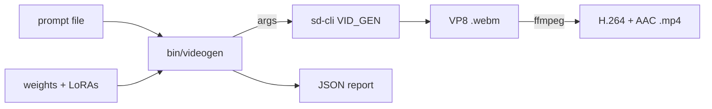

# videogen usage guide

Everything from a bare clone to a finished clip, plus the flags, the frame
rules, the memory arithmetic and the failures you are most likely to hit.

- [How it fits together](#how-it-fits-together)
- [What you need](#what-you-need)
- [The launcher](#the-launcher)
- [Build the runner](#build-the-runner)
- [Download and verify the weights](#download-and-verify-the-weights)
- [Your first clip](#your-first-clip)
- [Presets and profiles](#presets-and-profiles)
- [Canvas, frames and duration](#canvas-frames-and-duration)
- [CLI reference](#cli-reference)
- [Output and the report](#output-and-the-report)
- [Planning memory](#planning-memory)
- [Troubleshooting](#troubleshooting)
- [Verification status](#verification-status)
- [Where files go](#where-files-go)

## How it fits together



`bin/videogen` is a bash wrapper with two jobs: it turns a preset and a profile
into the exact `sd-cli` command line, and it remuxes the result, because
`sd-cli` in video mode writes VP8 `.webm` or MJPEG `.avi` and cannot write
H.264. The LoRA is applied through the prompt, with a
`<lora:name:weight>` tag, which is how stable-diffusion.cpp is designed to take
it.

## What you need

| Item | Detail |
|---|---|
| Host | Linux, arm64 or x86_64. The reference host is an arm64 machine with about 128 GB of unified memory. |
| Accelerator | A CUDA build uses `nvcc` from the CUDA toolkit. stable-diffusion.cpp also supports other backends; this recipe's build step covers CUDA. A CPU-only build runs but is impractically slow for video. |
| Memory | The standing profile is 44.9 GiB of weights held resident, plus the sampler's working set, which grows with the canvas. Plan for roughly 64 GB. |
| Disk | About 50 GB for the standing profile, the runner source and the build tree. |
| Tools | `git`, `cmake`, `make` or `ninja`, a C/C++ toolchain, `ffmpeg`, and either `curl` or the Hugging Face CLI (`hf` / `huggingface-cli`) for the downloads. |

## The launcher

`scripts/start-videogen.sh` does the setup work, one subcommand at a time. Run
it from the repository root.

| Subcommand | What it does |
|---|---|
| `recon` | Reports what the host provides: architecture, kernel, memory, free disk, the CUDA toolkit and its version, the accelerator and its driver, `ffmpeg`, Python, whether `sd-cli` is built, and how much weight data is already present. Read-only. |
| `build` | Clones and builds the runner into `bin/sd-cli`. |
| `download` | Fetches the standing profile from the pinned revisions. Resumable. |
| `verify` | Hashes the downloaded files against `models/SHA256SUMS`; `verify --write` creates or refreshes that ledger. |
| `status` | Prints the resolved root, whether `sd-cli` is built, the runner commit, the selected profile, every weight file present with its size, and the total on disk. |
| `clean` | Removes the runner's build tree. Weights and outputs are untouched. |

Every path and pin is overridable by environment variable (`VIDEOGEN_ROOT`,
`SDCPP_DIR`, `SDCPP_REPO`, `SDCPP_REV`, `CUDA_HOME`, `CUDA_ARCH`, `PROFILE`,
`ENCODER_FILE`, `HF_CLI`, `JOBS`, `FORCE`).

## Build the runner

```sh
bash scripts/start-videogen.sh build
```

That clones `leejet/stable-diffusion.cpp` into `.src/sdcpp` (recursively: its
`ggml` is a git submodule), configures a Release CUDA build, compiles it, and
copies the resulting binary to `bin/sd-cli`.

The build knobs, all overridable by environment variable:

| Variable | Default | Meaning |
|---|---|---|
| `SDCPP_REPO` | `https://github.com/leejet/stable-diffusion.cpp` | Source repository. |
| `SDCPP_REV` | empty (HEAD) | Pin a commit for a reproducible build. |
| `SDCPP_DIR` | `$VIDEOGEN_ROOT/.src/sdcpp` | Where the clone lives. |
| `CUDA_HOME` | `/usr/local/cuda` | Where `nvcc` is looked for. |
| `CUDA_ARCH` | `121` | `CMAKE_CUDA_ARCHITECTURES`. Set this to your GPU's compute capability. |

The equivalent manual configure is:

```sh
cmake -S . -B build -DCMAKE_BUILD_TYPE=Release \
  -DCMAKE_CUDA_COMPILER="$CUDA_HOME/bin/nvcc" \
  -DCMAKE_CUDA_ARCHITECTURES=121 -DSD_CUDA=ON
cmake --build build --config Release -j
```

If the build succeeds but `video generation is not supported` appears at run
time, the H3 path was not compiled in: check that you cloned the submodules
(`git submodule update --init --recursive`) and that the checkout is recent.

## Download and verify the weights

```sh
bash scripts/start-videogen.sh download
bash scripts/start-videogen.sh verify
```

`download` fetches the standing profile from [models/MANIFEST.md](../models/MANIFEST.md),
each file pinned to a repository revision: the pruned FL2VA Q8_0 DiT
(19.97 GiB), the Qwen3-VL-32B MiniMax-H3 text encoder (16.97 GiB), the fp16
video VAE and the fp32 audio VAE (5.41 GiB), and the two 4-step turbo LoRAs
(2.55 GiB). It is resumable: a file that is already complete is skipped, and a
re-run continues a partial one.

```sh
bash scripts/start-videogen.sh verify --write   # hash what you have into models/SHA256SUMS
bash scripts/start-videogen.sh verify           # check it again later
```

Two download details are worth knowing. The Hugging Face CLI is preferred when
it is installed, because it resumes inside its own cache and speaks Xet; the
`curl` fallback is pinned to HTTP/1.1 with `--retry-all-errors`, because an
HTTP/2 stream from the CDN was observed to abort mid-transfer and kill the
fetch. Set `FORCE=1` to re-download a file that is already present.

Profiles other than `q8` are selected with `PROFILE=`:

```sh
PROFILE=q6 bash scripts/start-videogen.sh download   # smaller DiT, smaller download
```

The audio VAE is fp32 on purpose. A bf16 audio VAE decodes the soundtrack
roughly 20 dB too quiet, which is why the reference deployment keeps both
autoencoders in float32 and why the manifest pins the fp32 file.

## Your first clip

```sh
bin/videogen --prompt-file examples/prompts/t2va-fox.txt --preset turbo
```

The output is `out/h3-<timestamp>-<seed>.mp4` next to a `.json` report. To see
the command that would run, without running it:

```sh
bin/videogen --prompt-file examples/prompts/t2va-fox.txt --preset turbo --dry-run
```

A short one-liner prompt is accepted positionally, which is fine for smoke
tests, but the model was trained on the field-structured prompt and a long
multi-line prompt has to come from a file:

```sh
bin/videogen "a red fox trots through a sunlit meadow" --seconds 3 --steps 8 --lora off
```

## Presets and profiles

The two dials are independent on purpose. A **preset** spends *time*: it
chooses a LoRA and a step count, with the weights unchanged. A **profile**
spends *memory*: it chooses how much of the transformer is quantized. Memory
buys weight fidelity; time buys sampling. Neither one recovers the other.

| Preset | LoRA | Steps | Notes |
|---|---|---:|---|
| `turbo` | larry, `ckpt850` | 6 | The reference deployment's own default. |
| `lightx` | lightx2v v1.2 | 4 | The more aggressive 4-step adapter. |
| `quality` | none | 28 | The base model's trajectory. Faces, references, fine detail. |

| Profile | DiT file | DiT size | Standing total |
|---|---|---:|---:|
| `q8` (default) | `minimax_h3_fl2va_pruned-Q8_0.gguf` | 19.97 GiB | 44.9 GiB |
| `q6` | `minimax_h3_fl2va_pruned-Q6_K.gguf` | 15.45 GiB | 37.8 GiB |
| `q4` | `minimax_h3_fl2va_pruned-Q4_K.gguf` | 10.64 GiB | 28.3 GiB |
| `base-q4` | `minimax_h3_fl2va-Q4_K_M.gguf` | 17.49 GiB | 42.4 GiB |
| `bf16` | `minimax_h3_fl2va_bf16.safetensors` | 61.73 GiB | 81.7 GiB and up |
| `int8` | `minimax_h3_fl2va_int8_convrot.safetensors` | 31.70 GiB | 51.7 GiB |
| `pruned-bf16` | `minimax_h3_fl2va_pruned_bf16.safetensors` | 37.46 GiB | 57.4 GiB |

The "standing total" column is the DiT plus the 16.97 GiB GGUF encoder and the
two VAEs; the `bf16`, `int8` and `pruned-bf16` rows load transformers
republished from the original weights as safetensors, of which only `bf16` is
the reference deployment's own bit width. Loading any of them here is
unverified; see [Verification status](#verification-status).

An explicit `--steps` or `--lora` always wins over the preset, and
`--profile` can be combined with any preset:

```sh
bin/videogen --prompt-file prompt.txt --profile q4 --preset turbo --steps 8 --lora lightx
```

Available LoRA names are the files in `models/loras`:

| Name | File |
|---|---|
| `larry` | `larry_4step_ema_ckpt850.safetensors` |
| `lightx` | `lightx_4step_v1.2_768p_comfyui_bf16.safetensors` |
| `off` | no adapter |

Any other value is treated as a filename inside `models/loras`, so a different
checkpoint can be dropped in and used directly.

## Canvas, frames and duration

Canvas defaults to `1344x768`, the native shape: a 768-pixel short edge, about
one megapixel, which is what the checkpoint was trained for. `--canvas WxH`
takes anything, and 960x544 is a useful cheap shape for smoke tests.

The video VAE only decodes frame counts on the `17 * n + 5` grid, so the CLI
rounds up silently: `--seconds 5` means 120 frames, which becomes 124 (5.167 s
at 24 fps), and an explicit `--frames 100` becomes 107. To know what a run will
use before starting it, read the frame count and duration the CLI prints on its
first line, or use `--dry-run`.

The native canvas is also the sharpest thing the model can do. Steps cannot add
detail the canvas cannot resolve, and the turbo adapters surface low-step
artifacts (a swimming grid over fine texture) sooner than the base model does.

## CLI reference

```
bin/videogen [PROMPT] [options]
```

| Flag | Default | Meaning |
|---|---|---|
| `--prompt-file FILE` | none | Read the prompt from a file. Required for the field-structured prompt. |
| `--preset NAME` | none | `turbo`, `lightx` or `quality`. |
| `--profile NAME` | `q8` | Weight ladder: `q8`, `q6`, `q4`, `base-q4`, `bf16`, `int8`, `pruned-bf16`. |
| `--lora NAME` | preset's | `larry`, `lightx`, `off`, or a filename in `models/loras`. |
| `--steps N` | preset's | Sampling steps. |
| `--canvas WxH` | `1344x768` | Output canvas. |
| `--seconds S` | `5` | Target duration; converted to frames at 24 fps and snapped to the grid. |
| `--frames N` | none | Explicit frame count; overrides `--seconds`. |
| `--seed N` | random | Sampling seed. Identical seed, prompt and settings reproduce a run. |
| `--cfg F` | `1.0` | Guidance scale. The model is guidance-distilled; leave it at 1.0. |
| `--init FILE` | none | Condition on an image (first frame). |
| `--end FILE` | none | Condition on a last-frame image. |
| `--encoder FILE` | `qwen3vl_32b_minimax_h3-Q4_K_M.gguf` | Text encoder file inside `models/sd`. |
| `--out FILE` | `out/h3-<date>-<seed>.mp4` | Output path. |
| `--extra "..."` | none | Extra arguments appended to the `sd-cli` command line. |
| `--dry-run` | off | Print the `sd-cli` command and exit. |

Environment overrides: `SD_CLI`, `SD` (weights directory), `LORA_DIR`,
`OUT_DIR`, `PROFILE`, `ENCODER`, `VIDEO_VAE`, `AUDIO_VAE`.

Under the hood the wrapper runs, for example:

```sh
sd-cli -M vid_gen \
  --diffusion-model models/sd/minimax_h3_fl2va_pruned-Q8_0.gguf \
  --vae models/sd/minimax_h3_video_vae_fp16.safetensors \
  --audio-vae models/sd/minimax_h3_audio_vae_fp32.safetensors \
  --llm models/sd/qwen3vl_32b_minimax_h3-Q4_K_M.gguf \
  --lora-model-dir models/loras \
  -p "<PROMPT><lora:lightx_4step_v1.2_768p_comfyui_bf16:1>" \
  -W 1344 -H 768 --video-frames 124 --fps 24 \
  --steps 6 --cfg-scale 1.0 --seed 42 --rng cpu --diffusion-fa \
  -o out/clip.webm -v
```

## Output and the report

A run writes two files:

- the clip, H.264 video plus AAC audio in an mp4 container, when `ffmpeg` is
  present. Without `ffmpeg` the wrapper leaves sd-cli's VP8 `.webm` in place
  and says so.
- `out/<name>.json`, the report: prompt, preset, profile, canvas, frames, fps,
  steps, LoRA, seed, cfg, generation seconds, output path, DiT and encoder
  filenames.

The report is the trace from a clip back to the configuration that produced it,
which is what makes a comparison run meaningful. Keep it with the clip.

## Planning memory

The standing profile is 44.9 GiB of files, and a run holds all of them
resident. The rest is working set, which grows with the canvas, the frame count
and the attention window.

Practical rules:

- Choose the profile first, then the canvas. The DiT is the single biggest
  item, and dropping one rung of the ladder frees more than shrinking the
  canvas does.
- The encoder can be shrunk separately with `--encoder`: the Q2_K_M GGUF is
  12.20 GiB against the standing Q4_K_M's 16.97 GiB.
- If the host is shared with another large model, size that one deliberately
  first, so the video job cannot push it into an out-of-memory kill. A video
  job that grows into memory does not fail politely.
- Watch the runner's own output: `sd-cli -v` prints the sampling progress, and
  the wrapper reports how long generation took when it finishes. Measuring a
  small canvas first is the cheapest way to learn the step time before
  committing to a native-canvas run.

## Troubleshooting

| Symptom | Cause and fix |
|---|---|
| `error: bin/sd-cli not built` | Run `bash scripts/start-videogen.sh build`. |
| `error: missing models/sd/...` | Run `bash scripts/start-videogen.sh download`, then `verify`. |
| Download aborts part way | Re-run `download`; complete files are skipped and partial ones resume. The `curl` path retries with HTTP/1.1 deliberately. |
| The CUDA build cannot find `nvcc` | Set `CUDA_HOME`, or install the CUDA toolkit. The build also needs `CUDA_ARCH` set to your GPU's compute capability. |
| `video generation is not supported` | The H3 path is missing from the build: update the checkout and make sure the `ggml` submodule is present. |
| No mp4, only a `.webm` | `ffmpeg` is not on the path. The webm has both streams, so it still plays. |
| The soundtrack is very quiet | Write `overall_soundscape` explicitly in the prompt instead of describing the audio inline. Measured here: the prose prompt came back at -57.6 dB mean, the field-structured prompt at -44.6 dB mean, same shape and seed. |
| Plastic, over-sharpened look | A turbo LoRA is running past its design range. Stay at 4-8 steps; beyond that the distilled adapter stops helping. |
| Swimming grid artifacts over fine detail | Too few steps for the content. Raise the step count, or use `--preset quality` for faces and reference-keyed shots. |
| Out of memory | Step the profile down (`--profile q6`, then `q4`) before shrinking the canvas, and check what else is resident. |
| The LoRA seems to have no effect | Look for `apply_loras completed` in the runner's output. With a quantized model the apply mode resolves to `at_runtime` automatically. |

## Verification status

Measured, on the reference host:

- 960x544, 73 frames, 20 steps, larry LoRA, pruned Q8_0 DiT: 648 s, with
  41,655 MB of peak memory released afterwards.
- 960x544, 73 frames, 6 steps, larry LoRA, pruned Q8_0 DiT (the `turbo`
  preset): 253 s.
- Soundtrack level: the prose-prompt run at 960x544 measures mean -57.6 dB and
  peak -33.9 dB, and the field-structured prompt at the same shape and seed
  measures mean -44.6 dB and peak -32.4 dB (both measured with ffmpeg's
  `volumedetect` over 196,608 samples).
- `apply_loras completed` in the runner's log, so the adapter is really applied.
- Every artifact downloaded byte-exact against the manifest, and every pin in
  `models/MANIFEST.md` re-verified against the live repositories when this
  repository was published.

Not measured, and not implied:

- The native 1344x768 canvas, and the peak memory a native-canvas request needs.
- The pruned-against-non-pruned A/B and the larry / lightx / off comparison at
  identical seed and prompt.
- Whether the larry LoRA's AdaLN targets bind on a pruned, curve-table model
  beyond the absence of an error.
- Loading any of the safetensors profiles (`bf16`, `int8`, `pruned-bf16`).

## Where files go

```
models/sd/        DiT, encoder and VAE files          (gitignored)
models/loras/     LoRA adapters                       (gitignored)
models/SHA256SUMS the local hash ledger               (gitignored)
out/              clips and JSON reports              (gitignored)
inputs/           images for --init / --end           (gitignored)
bin/sd-cli        the built runner                    (gitignored)
.src/sdcpp        the runner's source checkout        (gitignored)
```
